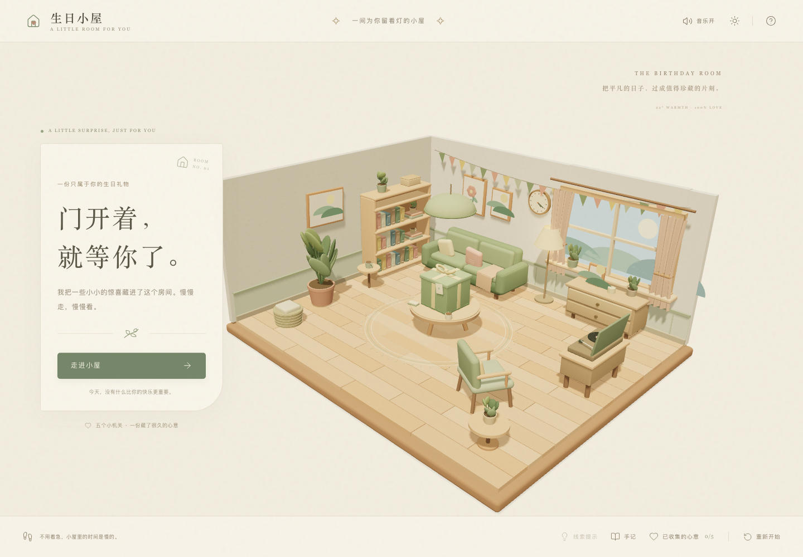
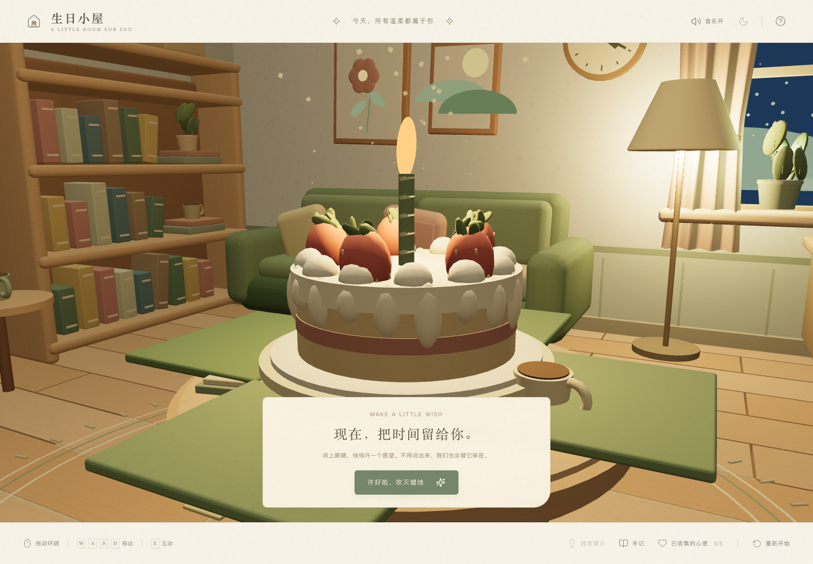
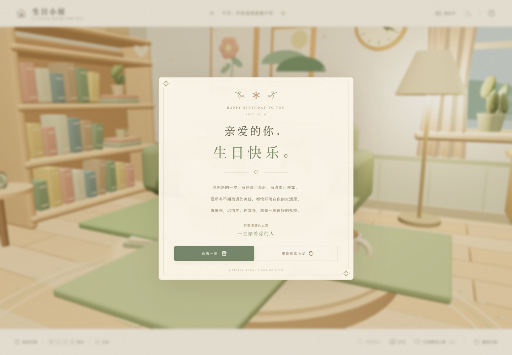
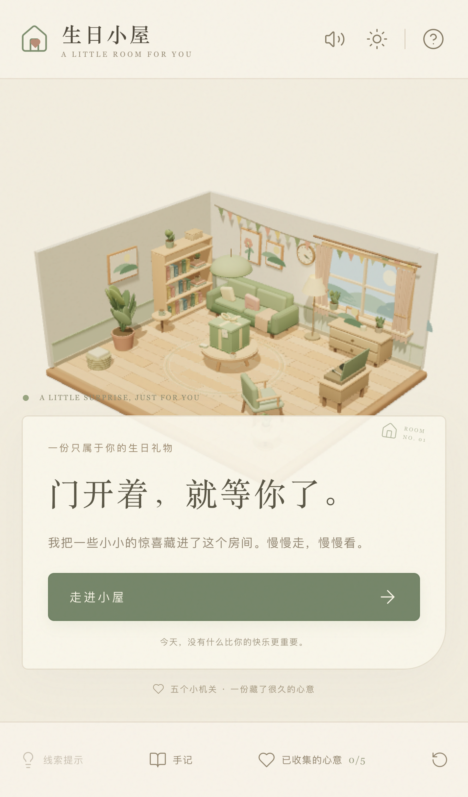

# Birthday Room · 生日小屋

**[直接打开小屋 · 在线体验](https://hhhoratioxu.github.io/Toolbox/BirthdayRoom/)** · 无需登录或安装，支持电脑和手机浏览器。

一间为你留着灯的小屋。一个真正可以走入、探索、解谜、打开礼物、许愿和吹灭蜡烛的 3D 生日网页游戏。

使用 React、TypeScript、Vite、Three.js、React Three Fiber、drei、Zustand、Tailwind CSS、Motion 和 Web Audio API。房间、家具、植株、纸张与木纹、礼物盒、蛋糕和特效全部由代码生成，无需下载模型或依赖外部音频服务。



## 本地运行

需要 Node.js 22.12+（推荐 Node.js 24）。

```sh
git clone https://github.com/hhhoratioxu/Toolbox.git
cd Toolbox/BirthdayRoom
npm install
npm run dev
```

访问终端显示的 `http://localhost:5173/`。开发服务器默认绑定所有网卡，手机与电脑在同一局域网时，可使用终端显示的 Network 地址。请使用可信的本地网络，不需要修改系统代理、防火墙或路由器。

工程同时提供 `pnpm-lock.yaml`，推荐用与 `packageManager` 一致的 pnpm 进行锁定安装：

```sh
pnpm install --frozen-lockfile
pnpm dev
```

生产构建与本地生产预览：

```sh
npm run build
npm run preview
```

构建输出为 `dist/`，可以部署到支持 HTTPS 的静态托管服务。应用不需要后端、账号、API 密钥或付费服务。

## GitHub Pages 部署

公开体验地址为 **https://hhhoratioxu.github.io/Toolbox/BirthdayRoom/**。

仓库的 [Pages 工作流](../.github/workflows/pages.yml) 在向 `main` 推送本工具的代码或 Pages 配置变更时自动运行，也可以在 Actions 中手动启动。它使用 Node.js 24 和锁定的 pnpm 版本安装依赖，执行单元测试，再构建并部署。仓库 Settings → Pages 的发布来源应选择 **GitHub Actions**。

`npm run build:pages` 会使用 `/Toolbox/BirthdayRoom/` 作为资源基础路径，适配 GitHub Pages 的项目子目录；普通 `npm run build` 和本地开发仍使用根路径。仓库改名或迁移时，需要同步调整 `build:pages` 中的路径和此体验链接。

部署状态见 [GitHub Actions](https://github.com/hhhoratioxu/Toolbox/actions/workflows/pages.yml)。

## 体验与操作

- 开场为完整的立体剖面房间，点击「走进小屋」后平滑切换到第一人称。
- 桌面：WASD 或方向键移动；鼠标控制已锁定视角；释放后按住鼠标拖动环顾；双击房间或点击底栏视角按钮重新锁定。
- E、点击模型或屏幕中央提示均可互动。可交互目标有较宽的识别角度和接近范围。
- Esc 释放鼠标或合上卡片；弹窗支持键盘 Tab 焦点循环。
- 手机：左下摇杆移动，右侧滑动环顾，右下「互动」按钮操作。支持横屏、竖屏和屏幕旋转。
- 「线索提示 → 带我去看看」会通过寻路，沿不穿过家具的小路行走到下一站；手动移动或转动视角可以取消引导。
- 「手记」「已收集的心意」可以重看祝福；重看不会重复增加进度。
- 支持白天与夜晚平滑切换，音乐开关、画质选择和本机进度保存。

## 故事流程（包含谜底）

1. **书架**：把颜色卡按绿叶、日光、云霞的顺序排列。错误顺序会提示并重置当前选择。
2. **时钟与抽屉**：时钟真实指向 4:20；输入三位密码 `420`，抽屉播放拉出动画。
3. **窗台植物**：收下关于成长与勇气的祝福。
4. **沙发抱枕**：发现浮动的 3D 小钥匙，领取后加入物品栏。
5. **唱片机**：完成前四环并持有钥匙后，放下唱针。第五份心意完成，绿色礼物盒解锁。

打开礼物后：镜头聚焦 → 光线渐暗 → 盒子轻颤 → 盒盖升起 → 四面铰接展开 → 蛋糕逐渐升起、放大 → 夜空与烛光 → 许愿 → 按钮吹灭蜡烛 → 火焰收缩、短暂烟雾、爱心与金色粒子 → 贺卡。

「再看一遍」重播完整礼物动画；「重新探索小屋」会先确认，再清除本机游戏进度。麦克风吹气不是必要环节，此版本使用每台设备都可用的按钮，不请求麦克风权限。

## 自定义生日信息

只需编辑 [`src/config/birthday.ts`](src/config/birthday.ts)。

| 配置 | 用途 |
| --- | --- |
| `recipient`、`date`、`sender` | 收礼人、生日日期和发送者 |
| `title`、`subtitle`、`pageTitle` | 顶栏与浏览器标题 |
| `welcome`、`notes`、`puzzles`、`finale` | 开场、谜题提示、祝福、最终贺卡文字 |
| `backgroundMusic` | 自托管音乐地址；留空使用原创合成配乐 |
| `theme` | UI 奶油色、文字色、鼠尾草绿、粉色与金色 |
| `enableDayNight` | 是否启用日夜变化 |
| `saveProgress` | 是否在 localStorage 自动保存进度 |

音乐文件可放在 `public/music/` 中，再配置成 `/music/your-track.mp3`。请自行确认音频的合法使用权。默认音乐、按钮音、线索音、抽屉音、礼物展开音、烛火氛围与庆祝音均由 Web Audio 合成。浏览器首次点击后才启动声音；关闭声音同时静音音乐和效果音。

场景材质与美术配色位于 `src/scene/materials.ts`。改变家具布局时，还应同步更新 `src/game/world.ts` 的碰撞边界、交互锚点和安全观察点。

## 项目结构

```text
src/
  config/birthday.ts       个性化信息、祝福、谜题与主题配置
  game/
    types.ts               游戏与交互类型
    store.ts               Zustand 状态机、顺序校验与进度持久化
    world.ts               房间边界、家具碰撞、交互定义
    navigation.ts          线索引导的网格寻路
    input.ts               键盘、摇杆与视角输入
    audio.ts               原创合成音乐与音效
  scene/
    Scene.tsx              Canvas、灯光、画质与 WebGL 生命周期
    Room.tsx               完整的程序化房间和家具
    Primitives.tsx         家具、植物、画框等可复用造型
    Player.tsx             第一人称、碰撞、视角与平滑引导
    Interactive.tsx        通用 3D 交互与高亮提示
    Gift.tsx               礼物、蛋糕、蜡烛、烟雾与庆祝特效
    materials.ts           纸张、木纹、布料纹理与色板
  ui/
    Interface.tsx          开场、导航、进度和最终祝福
    Dialogs.tsx            五个机关、手记、提示和设置
    MobileControls.tsx     触摸摇杆、滑动环顾和互动按钮
  App.tsx                  音频生命周期、加载与图形错误边界
  style.css                Tailwind 入口与手绘纸张风格
tests/
  world.test.ts            碰撞、边界、所有目的地的可达性
  game.test.ts             顺序、钥匙、去重、终局与重置
  e2e/room.spec.ts          桌面、移动 Chromium 与移动 WebKit 流程
artifacts/                 实际浏览器截图与交付验收记录
```

## 测试

```sh
npm test
npx playwright install chromium webkit
npm run test:e2e
```

`test:e2e` 会先重新构建，再以 `http://localhost:4173` 的生产预览进行验证。它不依赖全局安装的 pnpm。只读的截图与渲染后端采集脚本位于 `scripts/capture-evidence.mjs`，可在生产预览运行时用 `node scripts/capture-evidence.mjs` 重现最终首屏。

端到端测试通过可见按钮、真实键盘、触控和模型交互提示完成故事，没有调用状态修改后门。测试包含颜色和密码错误、顺序与礼物锁、进度计数、领取钥匙、刷新恢复、昼夜、连续展开、蛋糕、烛火熄灭、贺卡和重播。另有键盘移动、碰撞、鼠标环顾、触摸摇杆、横屏界面及 WebGL 不可用时的提示验证。

失败时输出 `test-results/` 截图与 trace；HTML 报告位于 `playwright-report/`。浏览器模拟移动设备可验证触摸逻辑与响应布局，不能代替真实 iPhone、Android 的 GPU、温度、续航与音频验收。实际执行结果见 `artifacts/ACCEPTANCE.md`。

## 性能与实现边界

- 地板和植株叶片、枝干使用 InstancedMesh，共享绘制与材质。
- 程序纹理仅在首次创建时生成并复用，不逐帧绘制画布。
- 只启用一盏投影光源；静态房间缓存阴影，在抽屉、房间结构或礼物发生运动时才重绘。
- 手机默认降低像素比与阴影分辨率；设置中可选择轻盈画质。
- 移动和特效使用帧循环与引用，避免每帧触发 React 状态更新。
- 碰撞使用带玩家半径的 AABB、细分步进和沿障碍滑动，寻路使用同一可行走空间。
- Canvas 随窗口自动调整；遇到 WebGL 初始化失败或上下文丢失时显示恢复说明。
- 部分 Canvas `data-*` 属性提供只读的位置、视角、帧率和动画观测信息，方便本地验收；它们不能控制游戏或跳过机关。
- 本机存档不是在线账号同步；清除浏览器网站数据后会重新开始。中途刷新礼物动画，会恢复到已完成贺卡，并可从贺卡重播。

默认配置未填写具体生日收礼人，使用「亲爱的你」作为可直接体验的版本。本项目依据文字需求进行原创实现；未收到参考视频，因此不声称逐帧复刻该视频。

## 实际截图

下列画面来自实际运行的 WebGL 应用，截图以无损 WebP 保存。

| 生日蛋糕 | 最终贺卡 |
| --- | --- |
|  |  |

<details>
<summary>查看手机首屏</summary>



</details>

## 许可与依赖

本工程原创源代码使用 MIT 许可，见 `LICENSE`。第三方开源依赖保留各自的许可，清单见 `THIRD_PARTY_NOTICES.md`。
