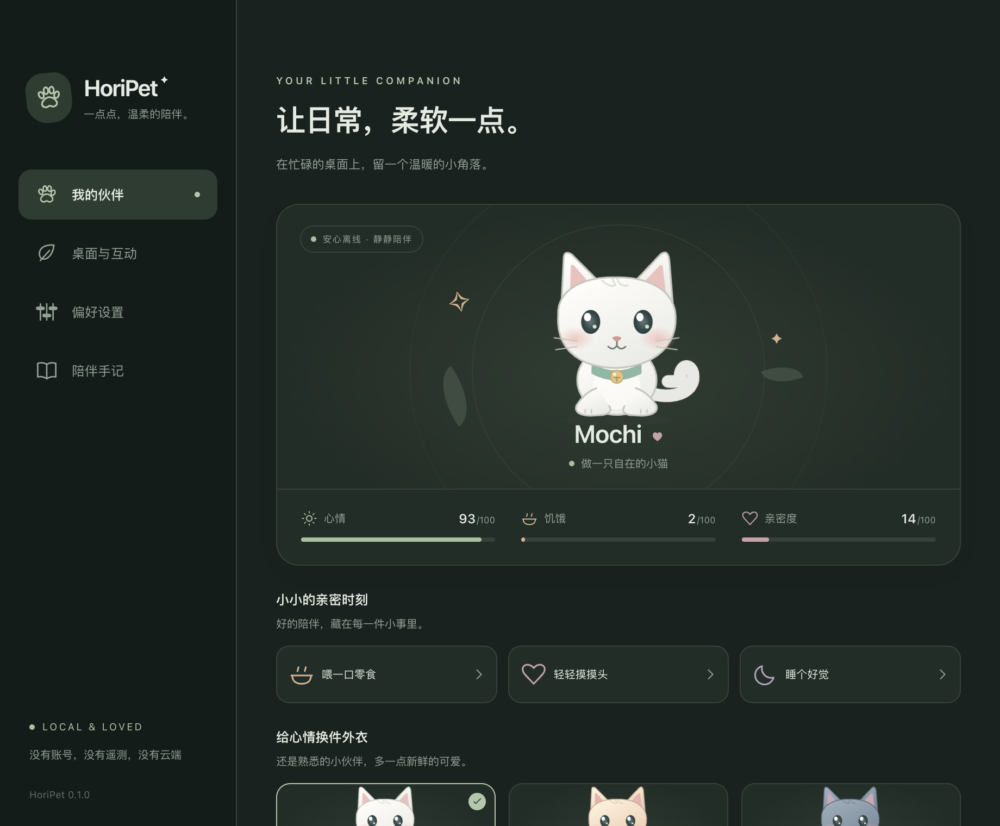

<p align="center"></p>
<h1 align="center">HoriPet</h1>
<p align="center">一点点，温柔的陪伴。<br/>A little company for your desktop.</p>
<p align="center"><a href="https://github.com/hhhoratioxu/Toolbox/releases/tag/horipet-v0.1.0-preview.5">下载预览版 / Downloads</a> · <a href="docs/VALIDATION.md">验证记录</a> · <a href="docs/ARCHITECTURE.md">Architecture</a></p>

HoriPet 是真正运行在桌面上的 Electron 宠物应用，支持 macOS 和 Windows。原创 SVG 小猫直接内置在应用中，透明小窗口不占满屏幕；核心功能完全离线，无账号、遥测或付费 API。

这是 **0.1.0 未签名预览版**。功能实现、构建成功、自动化桌面检查和人工设备验收是不同的验证层，具体见 [验证记录](docs/VALIDATION.md)。不要将构建成功理解为所有系统及硬件都已经人工验证。



## 能做什么

- 原创白猫、蜜桃牛奶和小小雨云三套皮肤；待机、行走、奔跑、睡觉、醒来、开心、抚摸、拖动、吃东西、鼠标跟随十种互斥状态。
- 拖动小猫搬家；单击随机互动，双击表达喜欢，右键打开原生菜单。
- 自动散步、打盹、开心；可暂停活动，可选择跟随附近的鼠标。长期空闲时减少位置轮询和动画更新。
- 多显示器工作区边界、负坐标、Electron DIP 坐标、热插拔恢复；记住位置并支持托盘一键找回。
- 本地名字、心情、饥饿和亲密度，喂食、抚摸、睡觉、气泡；原子保存和上次完整存档备份。
- 精致的独立设置窗口，三种主题、中英文、大小、动画和移动速度、显示隐藏、始终置顶、音效和登录时启动。
- macOS 菜单栏 / Windows 系统托盘。关闭设置后继续运行，从托盘可找回宠物或正常退出。
- 独立主进程 AI 扩展接口，当前没有任何 API 请求或密钥配置需求。

## 安装预览版

从 [Releases](https://github.com/hhhoratioxu/Toolbox/releases/tag/horipet-v0.1.0-preview.5) 选择对应架构：

| 电脑 | 文件 |
| --- | --- |
| Apple Silicon Mac | `HoriPet-0.1.0-mac-arm64.dmg` |
| Intel Mac | `HoriPet-0.1.0-mac-x64.dmg` |
| Windows 10/11 x64 | `HoriPet-0.1.0-windows-x64-setup.exe` 或 `portable.exe` |
| Windows ARM64 | `HoriPet-0.1.0-windows-arm64-setup.exe` 或 `portable.exe` |

Mac 打开 DMG 后将 HoriPet 拖到 Applications。Windows 安装程序按当前用户安装，普通功能不需管理员权限；Portable 可直接运行，但不提供开机启动。不要直接从 Mac DMG 中启用登录启动，应先安装。

预览版没有 Developer ID、公证或 Windows 可信代码签名。macOS Gatekeeper / Windows SmartScreen 可能阻止从互联网下载的文件；操作系统允许时，在核实来源和 SHA256 后使用系统提供的“仍要打开”流程。请勿关闭系统安全保护。此仓库不声称签名或公证成功。

首次运行默认显示小猫。通过菜单栏 / 系统托盘的猫图标打开偏好设置。若图标被系统折叠，请先展开托盘。

## 本地开发

需要 Node.js 24+ 和 pnpm 11.25.0；开发依赖会下载对应系统的 Electron。

```sh
git clone https://github.com/hhhoratioxu/Toolbox.git
cd Toolbox/HoriPet
corepack enable
corepack prepare pnpm@11.25.0 --activate
pnpm install --frozen-lockfile
pnpm dev
```

如果 Node 安装未包含 Corepack，可运行 `npm install --global pnpm@11.25.0`。

```sh
pnpm test             # 纯逻辑自动化测试
pnpm build            # TypeScript 检查与生产构建
pnpm start            # 启动生产代码，先执行 build
pnpm test:desktop     # 在当前系统上实际启动 Electron 做桌面自动化检查
```

`test:desktop` 使用独立 `.test-profile-smoke-*`，不会覆盖正常存档。报告和截图保存在 `test-results/<platform>-<arch>/`，不包含在消费者安装包中。需要可用的图形桌面会话。

Windows 桌面检查包括真实系统鼠标输入。Mac 的原生鼠标测试需要用户明确授权后编译并指定 `scripts/native-mouse.swift` 生成的驱动（`HORIPET_MOUSE_DRIVER`）；普通测试不会尝试获取辅助功能权限。`scripts/profile-idle.mjs` 可对真实运行的应用做短时资源采样。实际测试结果和 Electron 内存开销已记录在验证文档中。

## 构建安装包

Mac 上执行：

```sh
pnpm dist:mac          # Apple Silicon + Intel，分别输出 DMG 和 ZIP
pnpm dist:mac:arm64
pnpm dist:mac:x64
```

Windows 上执行：

```powershell
pnpm dist:win          # x64 + ARM64，各输出 NSIS 和 Portable
pnpm dist:win:x64
pnpm dist:win:arm64
```

输出位于 `dist/`。macOS 包应在 Mac 上构建，Windows 安装程序应在 Windows 上构建。GitHub Actions 对两种 Mac 架构和两种 Windows 架构分别构建、运行测试并上传产物；可运行对应架构的 runner 还会实际启动打包后的应用。Windows ARM64 在 x64 runner 交叉打包，不能据此宣称在 ARM 设备上运行通过。

推送 `horipet-v*` 标签会在全部构建成功后创建 GitHub 预览版并上传安装包和 SHA256 校验文件。当前签名配置明确保持未签名，不需要证书或付费 API。

## 本地数据与隐私

设置保存在 Electron 用户数据目录的 `companion.json`，备份为 `companion.json.bak`：macOS 通常位于 `~/Library/Application Support/HoriPet/`，Windows 通常位于 `%APPDATA%/HoriPet/`。实际位置由系统用户数据路径决定。

应用拒绝任意网络请求、权限请求、新窗口和页面跳转。Renderer 没有 Node 权限，开启 sandbox 和 contextIsolation；preload 只暴露具名操作，主进程重新校验来源、类型和范围。未来接入 AI 时，Provider 和系统安全存储必须保留在主进程，不能将 API Key 传入前端。

## 工程结构

```text
src/
  main/
    index.ts                 应用生命周期与安全策略
    windows.ts               原生窗口创建
    ipc.ts                   来源校验、限流、具名操作
    tray.ts                  原生菜单栏与系统托盘
    persistence.ts           原子保存与备份恢复
    behavior/machine.ts      宠物状态机
    desktop/controller.ts    移动、拖动、穿透、屏幕恢复、养成
    platform/{mac,windows}.ts 平台差异与登录启动
    ai/provider.ts           可选扩展契约与离线 Provider
  preload/index.ts           隔离的安全桥接
  shared/                    类型、校验和 DIP 几何运算
  renderer/
    pet/                     原创 SVG、动画与手势
    settings/                设置窗口和原创图标
    i18n.ts                  中英文本
    store.ts                 Zustand 状态同步
tests/                       逻辑测试
scripts/                     图标生成与真实桌面检查
resources/                   内置图标、托盘素材
docs/                        架构、验收与发布说明
.github/workflows/           双平台构建与发布
```

源码及原创角色按 [MIT](LICENSE) 开源。Electron、React、Zustand 等依赖保留各自许可，见 [第三方声明](THIRD_PARTY_NOTICES.md)。
