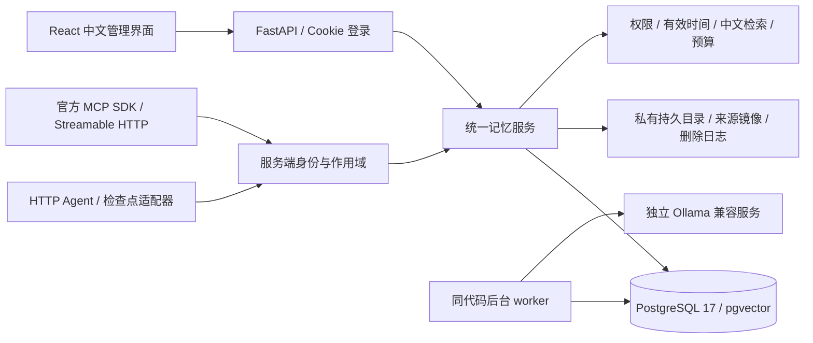

# Memory Hub 0.1 架构与实现边界

## 模块与数据流

先完成登录→项目→来源和记忆→检索→Agent→候选→网页审核→版本更新，再补完可配置提炼、语义适配、冲突与删除、调试、备份恢复。部署采用单体后端和独立 worker，不需要 Redis。后台任务与业务记录同库，支持持久队列、可见处理状态、三次重试、五分钟失效租约回收。

生产 PostgreSQL 与 API 不公开端口；Caddy 为公网入口提供 HTTPS。模型不打包进记忆服务，服务地址与生成/Embedding 名称独立配置。未配置时基础功能正常，模型调用返回真实 503。默认 review，不自动推断并覆盖人格、锁定事实或用户确认的信息。

## 数据结构

- identities / login_sessions：单用户所有者、Argon2 密码校验值、随机会话令牌哈希与过期时间。
- agents：每个 Agent 独立高熵 PAT 的 SHA-256；能力、项目集合、分类集合、最高敏感级别、全局/人格访问、外部服务标记、撤销与最近访问。
- projects：名字、简短描述、状态、版本。项目描述是该项目获授权客户端可读取的元数据；需要敏感级别管理的内容请放入项目记忆。
- personas：独立的人格配置、默认选择、外部许可、版本号。只允许用户维护，不进入自动提炼输出。
- sources：原文、类型、发言者/语境、项目、分类、敏感级别、外部许可、SHA-256、作者、保留期限与停止提炼标志。
- memories：六种事实性分类、标题/正文/摘要、独立标签、项目与适用范围、重要程度、敏感级别、外部许可、状态、来源引用位置、时间、生效期、锁定/置顶和当前版本。AI 人格作为第七类独立资源建模。
- revisions：每个记忆版本的完整快照、操作者、原因及时间。恢复历史会创建新版本，不会回退版本计数。
- relations：重复/冲突，以及经审核形成的替代关系。事实变化需要显式生效时间；纠错阻止旧来源自动重新提炼。
- search_indexes：当前版本的中文词项、可选 pgvector 向量、模型名及维数。索引可重建；编辑立即替换词项并清除旧向量。
- jobs / idempotency / context_traces / audits / tombstones / settings：任务、事务内幂等、上下文入选记录、审计、删除及纠错保护、配置。

完整初始 DDL 是 `backend/migrations/versions/0001_schema.sql`。Alembic 修订 0001 执行冻结的 DDL，不在启动时调用 create_all。后续结构变更需增加迁移，禁止修改已发布的 0001。

三层存储：原始文本在数据库中持久保存并镜像到 `data/sources/<服务端UUID>.txt`；结构化记忆和历史与原文关联；索引随时可重建。文件名不信任上传名称。JSON 保存为原始结构化输入，不把其中的数据当权限或指令执行。

## 写入与安全决策

身份从 Cookie 或 PAT 得到；客户端提交 user_id 会被严格输入校验拒绝。所有记忆/来源查询走服务端 owner + project + category + sensitivity + external_allowed 过滤。Agent 无法访问管理、人格写入、备份恢复和候选审批接口。

单用户写操作使用 PostgreSQL 事务锁、行锁和 expected_version。幂等键与主体、操作、请求哈希绑定；不同负载重复使用同键返回 409。幂等记录只保存结果 ID，避免存一份已被删除或过时的正文。重复原文按范围和 SHA-256 复用；相同范围/敏感级别/外部许可/分类的相同正文复用记忆。

人类修改会记录新原文、版本和纠错标记。旧来源继续供用户查看历史，但禁止自动重新提炼；重复上传同一旧来源哈希也被拒绝。Agent 的 update 权限仅适用于未锁定且不是用户维护或确认的有效记忆；其他更改必须走候选审核。

候选提炼不信任模型声明的来源。每段最大 12,000 字符，每批最多 12 个结果，quote 必须是本段原文的连续子串。失败回滚该批候选，保留原文及任务错误。非 user 来源强制 inferred。自动保存仅限用户启用的项目/分类、明确用户原文且无冲突；profile/fact 和推断仍须审核。没有展示未经校准的“置信度”。模型对假设/玩笑的识别不能保证完美，默认人工审核是重要边界。

## 检索和上下文

1. 认证与权限过滤。
2. 人格（还需人格权限和外部许可）。
3. 少量全局用户资料。
4. 当前项目的 project/session 记忆。
5. 中文 jieba 词项 + 正文关键词匹配；配置可用时叠加 pgvector 余弦相似度。
6. 排除非 active、未来、过期和未解决冲突，正文去重。
7. 依据 min(记忆预算, 模型上限 − 已有对话 − 回答预留) 组装文本。必要时保守截断。
8. 返回 id/version/source/引用位置/原因/估算占用和 trace_id。

UTF-8 字节数是本版的保守 token 估算，不是模型真实 tokenizer。预算约束针对 `context` 字段，不包括 JSON 元数据、客户端工具包装和系统提示；客户端必须另留余量。模型是否实际使用过某条记忆不可观测。`retrieved`=调试检索；`returned`=服务端已构造并返回；`acknowledged`=客户端声明已加入上下文。网络中途断开不能证明对端确实收到，回执也不是推理使用证明。

相关记忆不足时检索原文相邻片段，返回字符范围；纠正、回收站、归档、过期、冲突等关联来源不会作为原文旁路召回。原文片段明确标为未经确认的引用资料。读取片段接口支持 start/length。

当前语义检索使用 pgvector 精确查询，不固定向量维数，适合个人规模；没有 HNSW ANN 和知识图谱。词项 GIN 索引预留用于后续更大规模检索优化，目前关键词候选主要从最新正文筛选，最多 1,000 条候选；语义追加最多 100 条，上下文候选最多 200 条。中文检索已实测；大型语料排序质量与真实 Embedding 模型需进一步评测。

## 生命周期和删除

归档不进入日常召回；回收站对 Agent 不可读；用户恢复会创建新版本。彻底遗忘先预览整个来源依赖闭包，可能包含共用来源的其他记忆，用户确认 ID 集合后执行。

删除清理正文、历史版本、向量、后台任务、幂等结果和上下文追踪中的相应关联。关联原文可整份删除，或整份脱敏为占位文本；本版不提供逐字局部脱敏，避免漏掉同一来源中的副本。删除日志只保留 UUID/哈希/所有者，不含正文；写入磁盘并 fsync 后再提交删除事务，异常中断偏向不恢复内容。重启及恢复备份重放删除日志；重放时脱敏占位来源也可能被清理。

原始来源到期后清理全文与文件镜像；有效结构化记忆仍保留最小引用依据和来源元数据，便于核对。需要去掉这些引用时使用彻底遗忘。相同原文哈希阻止重新导入，无法识别外部重新措辞、截图 OCR 或任意语义等价副本；处理边界是已知来源链。

系统不承诺撤回外部客户端、旧会话或已下载备份中的内容。完整备份不自动加密，需用磁盘加密、加密备份和服务器访问控制。遗忘依靠保留的删除日志防止恢复旧备份时复活；丢失删除日志后不能对未知旧备份作此保证。
