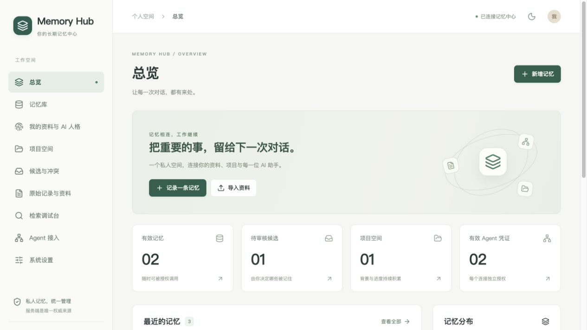

# Toolbox

个人实用小工具合集。每个工具放在独立目录，包含完整源码、启动方法与真实验证记录。

| 工具 | 用途 | 状态 |
|---|---|---|
| [Memory Hub](MemoryHub/) | 部署在私人服务器上的 AI 长期记忆中心：中文管理界面、项目与人格、授权检索、HTTP / MCP、候选审核、来源与版本、备份恢复 | v0.1.0；本机闭环已验证，详见验收报告 |

## Memory Hub



- [快速启动与目录说明](MemoryHub/README.md)
- [私人服务器部署](MemoryHub/docs/DEPLOYMENT.md)
- [Agent 配置与示例](MemoryHub/docs/AGENTS.md)
- [逐条验收结果](MemoryHub/docs/VERIFICATION.md)
- [已实现与限制](MemoryHub/docs/STATUS.md)

```sh
git clone https://github.com/hhhoratioxu/Toolbox.git
cd Toolbox/MemoryHub
cp .env.example .env
# 设置随机 POSTGRES_PASSWORD；本地运行使用以下命令
docker compose -f compose.yml -f compose.local.yml up -d --build
docker compose exec api python -m app.cli init --username admin
```

本地管理入口为 `http://127.0.0.1:8765`。公网部署需要域名、HTTPS 和独立凭证，完整说明见部署文档。

仓库只包含程序、示例配置和明确标注的验收证据；不包含真实密码、Agent 令牌、个人记忆、数据库或私人备份。示例中的模型服务与域名需要自行配置。

新增工具时建立独立目录，并在上表登记用途、运行入口和验证边界。各工具的许可证以对应目录为准；Memory Hub 的原创代码采用 MIT。
