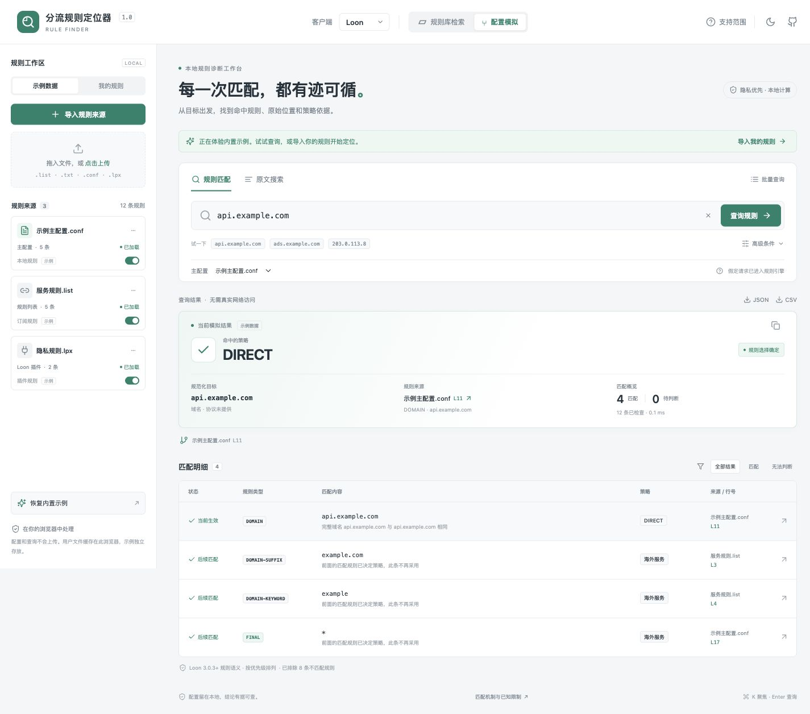
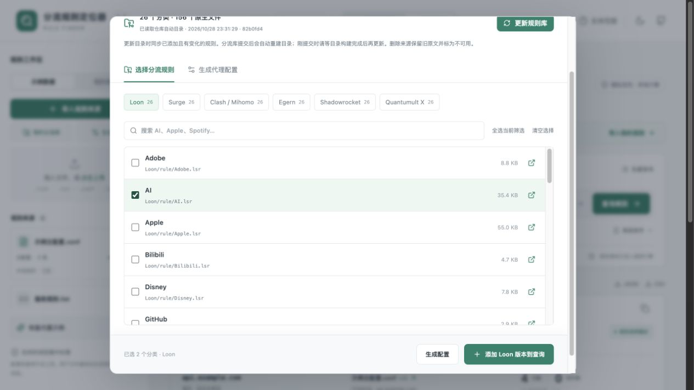
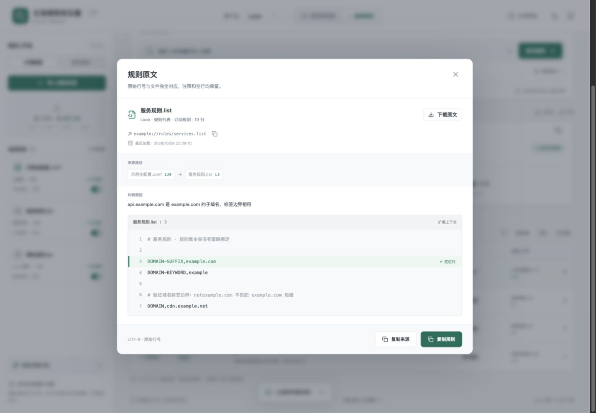

# 分流规则定位器 · Rule Finder

一个在浏览器本地运行的中文 Loon 分流规则检索与配置模拟工具。输入域名、完整 URL、IPv4 或 IPv6，查看匹配规则、原始行号、策略绑定和完整来源链。

**在线使用：[打开 Rule Finder](https://hhhoratioxu.github.io/Toolbox/RuleFinder/)**



## 开始使用

网页首次打开的是独立的离线示例工作区，不请求任何远程订阅。

1. 点击「导入规则来源」，粘贴规则、选择多个文件，或添加远程 URL。
2. 独立规则文件使用「规则库检索」；主配置使用「配置模拟」。导入时会按内容选择相应模式。
3. 主配置中的 `[Remote Rule]` / `[Plugin]` 引用会列为依赖。点击左侧「加载未就绪的引用」获取对应资源，不自动请求配置中其他地址。
4. 输入目标，按 Enter 或点击查询。点击结果行查看高亮原文、附近上下文和引用路径。
5. 在「高级条件」补充 IP、端口或 TCP / UDP。只有确认 DNS 集合完整、或确定实际连接 IP 时，才勾选对应选项。

「批量查询」每行一个目标，最多 200 行；使用按钮或 ⌘ / Ctrl + Enter 执行。JSON / CSV 导出包含各目标的匹配、未知项、行号、策略和来源路径。「原文搜索」独立查找注释、规则和策略名称，文本命中不代表实际请求匹配。

示例目标：`api.example.com` 命中本地 DIRECT；`ads.example.com` 命中插件 REJECT；`a.example.com` 经订阅引用绑定到「海外服务」；`203.0.113.8` / `2001:db8::1` 命中本地网段。

## 我的分流库与更新

v1.1 接入 [hhhoratioxu/Proxy](https://github.com/hhhoratioxu/Proxy) 的六客户端原生分流目录。当前目录有 26 个分类、156 个文件；数量来自目录内容，后续新增分类无需改前端代码。

1. 点击左侧「我的分流库」，按分类搜索、勾选，或「全选当前筛选」。六个客户端页签展示各自的原生文件。
2. 点击「添加 Loon 版本到查询」，下载这些分类的 Loon `.lsr` 文件，加入「我的规则」。下载固定到目录记录的提交，并校验真实 Git blob SHA；原文查看器也定位到该已加载提交。
3. 以后在 Proxy 仓库新增、修改或删除分流文件，[自动目录工作流](https://github.com/hhhoratioxu/Proxy/actions/workflows/rule-catalog.yml)会重新生成公开目录。等工作流完成后，回到网页点击「更新规则库」。
4. 网页更新分类目录，并同步工作区内已添加且内容有变化的规则。新增分类会出现在选择列表；未选择的分类不会擅自加入。已删除来源保留旧原文并标为不可用；失败来源可重新更新，失败不会冒充成功。

打开规则库时会检查目录，手动更新按钮始终可用。公开目录地址为 [Docs/RuleFinder-Catalog.json](https://raw.githubusercontent.com/hhhoratioxu/Proxy/main/Docs/RuleFinder-Catalog.json)，由仓库推送触发生成，避免正常使用依赖匿名 GitHub API 额度；目录暂时不可用时才尝试 GitHub API。两者失败时保留上次缓存并提示错误。目录显示生成时间与规则版本；仓库刚提交时需要等待自动目录任务完成。

旧版本手动添加的 `hhhoratioxu/Proxy/main/Loon/rule/…` Raw 来源也可纳入此更新流程。其他仓库、固定提交 URL 和手动替代的其他订阅不被当作该仓库的实时规则。现有用户来源的启用状态在更新时保留。



## 生成代理配置

在「生成配置」中，使用已选分类生成 **Loon、Surge、Clash / Mihomo、Egern、Quantumult X、Shadowrocket** 的各自原生配置或分流片段。可以设置分类策略、顺序、兜底策略，并下载当前客户端文件、复制预览或下载六端 ZIP。Loon 完整配置可直接「放入配置模拟」，同时载入其依赖并选中新的主配置。

- 新选择的分类默认 `DIRECT`，请按需改为 `REJECT` 或「节点选择」。没有按文件名推断策略或自动把所有流量交给代理。
- 所有生成的规则订阅地址跟随 Proxy 的 `main` 分支。原分类内容修改后，在代理软件里刷新该规则订阅即可获得修改；**新增分类需要回到工具更新目录、选择后重新生成配置**。客户端已导入的旧配置不会自动出现新的分类引用。
- 可选填自己的 HTTP 节点，凭据只保存在当前页面内存与下载文件中。未填节点时，完整基础配置的选择组只有 `DIRECT`；需要代理时，应填写真实节点或在客户端添加节点并调整组成员。HTTP 节点只覆盖 TCP。
- 分流片段不定义代理节点或策略组，引用「节点选择」时现有配置必须定义同名组。完整基础配置没有包含 MITM、重写、插件或 DNS 定制。
- 订阅更新间隔只写入各客户端已核对的原生参数。Loon、Shadowrocket 的更新周期交给客户端管理。
- 配置生成与规则模拟的支持范围独立。当前查询引擎仍只有 Loon；其他五端不会出现在查询客户端选择器中。Shadowrocket 为兼容配置导出，完整官方规范未取得，明确标为未完成原生导入验收。

生成格式核对依据：[Loon 订阅规则](https://nsloon.app/docs/Rule/sub_rule/)、[Loon 节点](https://nsloon.app/docs/Node/)、[Surge RULE-SET](https://manual.nssurge.com/rules/ruleset.html)、[Surge 策略](https://manual.nssurge.com/policies/overview.html)、[Mihomo rule-providers](https://wiki.metacubex.one/en/config/rule-providers/)、[Egern 规则](https://egernapp.com/docs/configuration/rules/)、[Egern 策略组](https://egernapp.com/docs/configuration/policy_groups/)和 [Quantumult X 开发者示例](https://github.com/crossutility/Quantumult-X/blob/master/sample.conf)。这些格式检查未扩大为真实客户端、节点连通性或设备流量通过。

## 两种工作模式

| 模式 | 结论 |
| --- | --- |
| 规则库检索 | 每个启用文件只搜索一次，列出所有匹配与无法判断项。没有显式策略时显示「未提供策略绑定」，不按文件名、分类或导入顺序猜测策略。文件内显式写出的策略只作为原文声明展示。 |
| 配置模拟 | 只展开所选主配置与它实际引用的资源，独立导入的其他文件不会被悄悄注入。按 Loon 规则阶段、来源和配置位置模拟首个生效规则；更早未知项使后续匹配成为候选。 |

「规则选择确定」只表示在当前静态条件和支持范围内可以确定规则及策略名。策略组的当前节点、连接成功与否、设备行为不在该结论内。已加载依赖缺失时另行标出「部分结果」，即使更高优先级的本地规则已足以确定策略，明细仍不会冒充完整。

## 支持范围

查询与模拟 UI 仅提供 **Loon**。Surge、Clash / Mihomo 通过独立 `Adapter` 接口预留扩展，不在查询选择器中展示尚未实现的适配器。规则目录与配置导出另行提供上述六种格式。

| 类别 | 已实现 |
| --- | --- |
| 域名 | `DOMAIN`、`DOMAIN-SUFFIX`（包括自身与标签边界）、`DOMAIN-KEYWORD`；大小写、末尾点和 IDN / Punycode 规范化。 |
| IP | `IP-CIDR`、`IP-CIDR6`；严格地址校验与真正的 CIDR 运算，包括 /0、/32、/128 边界；IPv4 与 IPv6 不隐式混合。 |
| 兜底与条件 | `FINAL`；`DEST-PORT` 单端口、闭区间、`>` / `>=` / `<` / `<=` / `=`；`PROTOCOL` 的明确 TCP / UDP 条件。 |
| 配置与规则集 | `.lsr` / `.list` / `.txt` 原生列表，`.conf` 中的 `[Rule]`、`[Remote Rule]`、`[Plugin]`；`.lpx` / `.plugin` 的规则段；`[Proxy Group]` 静态成员。 |
| 引用参数 | 位置式策略或 `policy=`、`enabled=true/false`、`tag=`。更新间隔参数仅记录为静态快照，不启动定时刷新。其他参数标明未支持。 |
| 原文 | 完整保留注释、空行、换行格式和原始文本。规则 ID 由来源、原始行号与内容摘要组成。未取得依赖文件时显示「待加载」，不会编造文件行号。 |

Loon 的依据是 [官方规则概览](https://nsloon.app/docs/Rule/)、[域名规则](https://nsloon.app/docs/Rule/domain_rule/)、[IP / no-resolve](https://nsloon.app/docs/Rule/ip_rule/)、[订阅规则](https://nsloon.app/docs/Rule/sub_rule/)和[端口规则](https://nsloon.app/docs/Rule/port_rule/)。核对日期：2026-10-28。

匹配以 Loon 3.0.3+ 规则引擎为基础：域名目标先匹配域名阶段；随后检查 IP / 其他条件；各阶段本地规则先于插件、插件先于订阅，同来源按配置位置；FINAL 最后。未知或混合规则保守放到可能的最早阶段。本版不会擅自认为精确域名天然高于更早的后缀规则。

`no-resolve` 严格采用上述 **Loon 文档**中的 IP 字面量限制，域名请求即使补充 DNS IP 也跳过；不会套用 Surge 的“已有解析 IP”语义。没有此参数时，缺少 IP、DNS 集合不完整或多个 IP 结论不一致，都会保留无法判断。

## 已知限制

- `DOMAIN-WILDCARD`、`GEOIP` / `IP-ASN` 数据库、GEOSITE、进程、HTTP / URL 正则、脚本、`AND` / `OR` / `NOT` 和其他未知类型仅保留原文并显示无法判断。表达式使用引号与括号感知的词法处理，未用逗号直接拆散嵌套表达式；首版不执行它们。
- 模拟假定请求已经进入 Loon 规则引擎、客户端处于规则模式。General 中的 TUN / HTTP 代理绕过、DNS / Host 覆盖、IP Rewrite、MITM、Rewrite、资源解析器和运行时脚本不参与模拟；原文保留，相关非规则段会提示其范围。
- 策略组仅展示静态组名、类型和成员。select、url-test、fallback 当前选中了哪个节点，需要客户端运行状态，工具不会猜测。
- YAML / YML 能被导入和查看，但会标记为尚未支持，不能当作 Loon 原生配置模拟。二进制数据库不支持。
- 远程文件受浏览器 CORS、HTTPS 混合内容与网络策略约束。HTTP 错误、超时、取消、格式和大小错误可单独识别；浏览器的 `TypeError` 无法可靠区分 CORS、证书和网络中断，因此显示「CORS / 网络错误」，不捏造诊断。
- 单文件 5 MiB，最多 40 个来源、约 30 MiB 原文，单批 200 个目标；引用展开最多 12 层，有循环检测，手动加载每次最多尝试 30 个依赖。原文搜索最多返回 1000 个命中，结果每页 25 项。
- 刷新远程来源失败后，保留之前的原文与最近成功时间供检查，但不把旧缓存作为当前确定的规则。暂停或取消的请求不会被当作成功。
- 从「我的分流库」下载的来源定位到已加载提交，保留稳定的 main 订阅地址供更新。普通手动 GitHub 导入的定位链接仍指向来源 ref，分支内容可能继续变化；导入 commit SHA 的 Raw 地址可获得固定版本。其他网站不生成猜测性的文件行链接。
- 本项目是本地静态诊断工具，未声称通过真实 Loon 设备或流量验收。

加载失败的依赖可在原文查看器里点击「粘贴内容以替代此引用」，填写匹配的引用 URL。手动停用来源、替代依赖或修改高级条件后，会标为当前模拟和已调整条件。

## 隐私和存储

用户规则原文与规则目录缓存只保存在当前浏览器的 IndexedDB，主题保存在 localStorage；查询目标只在内存中处理。没有后端、分析脚本、外部字体或自动 DNS 查询。打开「我的分流库」会请求公开目录，添加规则时只下载所选资源；加载远程资源使用 `credentials: omit` 和 `no-referrer`，不向资源服务器发送整份配置或查询目标。可选节点凭据不写入工作区或目录缓存。

「示例数据」与「我的规则」独立管理。可以下载来源原文备份，或在左侧清除用户工作区。浏览器禁止持久存储时仍可使用当前会话，会显示无法缓存的提示。多个网页在同一浏览器来源下的安全边界由浏览器本身提供，不将 IndexedDB 描述为加密保险库。

## 本地运行

需要 Node.js 24 与 pnpm 11.25.0。

```bash
npm install --global pnpm@11.25.0
cd RuleFinder
pnpm install --frozen-lockfile
pnpm dev
```

打开终端显示的本地地址。生产构建与检查：

```bash
pnpm test
pnpm build
pnpm preview
```

GitHub Pages 子路径构建：`pnpm build:pages`。仓库根目录的 `.github/workflows/pages.yml` 会验证并打包本项目，发布到 `/Toolbox/RuleFinder/`，同时保留 BirthdayRoom 及仓库首页。

## 代码结构与扩展

```text
src/core/input.ts                  输入、IDN、IP 与 CIDR
src/core/syntax.ts                 引号 / 嵌套括号感知的词法处理
src/core/adapters/loon-parser.ts   Loon 文件、配置、引用解析
src/core/adapters/loon-matcher.ts  Loon 三态谓词与优先级
src/core/adapters/index.ts         仅注册已交付客户端
src/core/engine.ts                 域名索引、来源链、优先级与不确定性传播
src/worker.ts                      后台解析、查询、批量和原文搜索
src/services/                     Worker 接口、远程加载、缓存、导出
src/library/                      仓库目录、版本同步、六客户端配置生成
src/components/                   来源、导入、结果、原文和支持范围界面
tests/                            易误判场景、远程错误与十万条规则回归
public/examples/                  可下载的原生示例文本
```

新客户端需单独实现解析、谓词和排序，见 [适配器规范](docs/ADAPTERS.md)。[Surge 官方文档](https://manual.nssurge.com/rules/overview.html)的逐行优先级、pre-matching 与 RULE-SET 参数，以及 [Mihomo 官方文档](https://wiki.metacubex.one/en/config/rules/)的 YAML / rule-providers / MATCH，不会通过改名复用 Loon 的语义。

## 验证

执行 `pnpm test` 可复现 132 项检查，包括用户列出的十项验收场景；另有远程 HTTP / 格式 / 取消 / 超时 / 大小限制、CSV 注入保护、10 万条规则解析和索引匹配回归，以及新增 / 修改 / 删除目录、SHA 字节校验、原生配置与 ZIP 导出。

基础浏览器验收步骤与证据边界见 [VERIFICATION.md](docs/VERIFICATION.md)，v1.0 的 GitHub Pages 与线上 Raw 导入检查见 [发布记录](docs/DEPLOYMENT.md)，规则库与配置生成功能见 [v1.1 验证记录](docs/VERIFICATION-v1.1.md)。原文查看器示例：



## 许可

原创项目采用 [MIT](LICENSE)。React、Vite、ipaddr.js、Lucide 等依赖保留各自许可证；锁文件固定实际安装版本。
